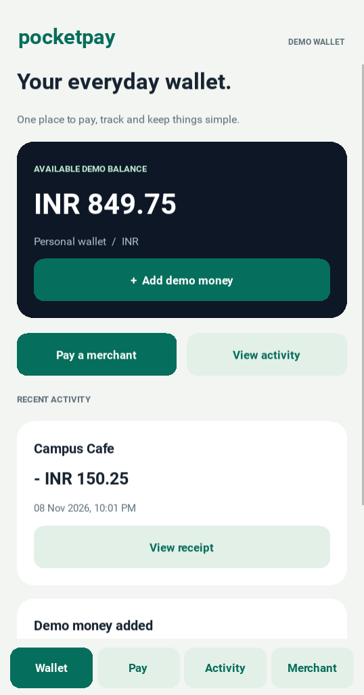
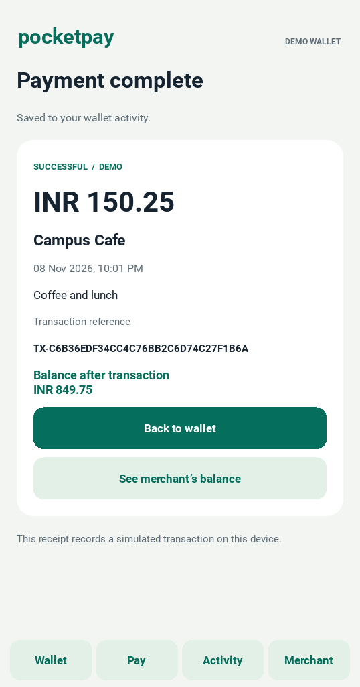
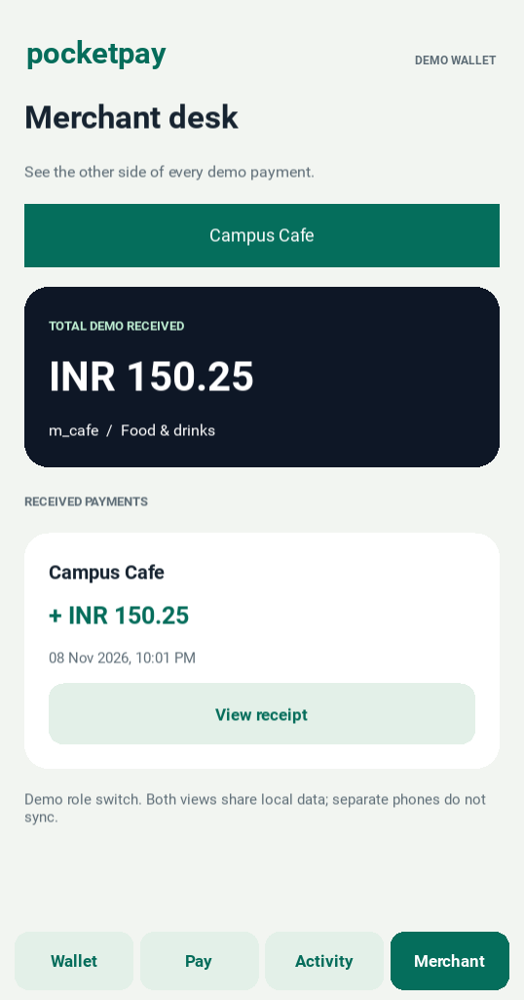

# PocketPay

**Mobile Wallet with Merchant Payment Using Android** — a Python and Kivy college/demo project.

Add simulated INR to a wallet, pay one of three merchants, review a receipt, and inspect both customer and merchant history. All balances start at zero and stay on one device in SQLite. There is no bank connection, real money, sign-in, or separate merchant device.

## App preview

Captured from the running Kivy desktop app using temporary demo data:

<p>
  
  
  
</p>

**Verified locally:** 23 wallet tests and the full desktop UI smoke test pass on Windows with Python 3.12 and Kivy 2.3.1, including repeated confirmation events. Android build and phone testing remain pending.

## What is included

- Wallet balance and demo top-ups.
- Merchant selection, amount entry, optional note, and payment confirmation.
- Receipts with transaction reference and time.
- Customer history and a merchant dashboard.
- Integer-paise accounting, atomic transactions, and safe retries.
- Automated wallet tests, a desktop UI smoke test, and an Android APK build workflow.

The Android packaging configuration is provided, but an APK build and physical-device validation are **not yet verified**. Desktop execution does not prove Android compatibility. Use the checklist in [the demo guide](docs/DEMO.md) after building.

## Run on Windows

Install 64-bit Python 3.12 and Git, then open PowerShell in this project's folder, the one containing `main.py`. These commands use the environment's Python directly, so PowerShell activation settings do not need to change.

```powershell
py -3.12 -m venv .venv
.\.venv\Scripts\python.exe -m pip install --upgrade pip
.\.venv\Scripts\python.exe -m pip install -r requirements.txt
.\.venv\Scripts\python.exe main.py
```

If `py` is unavailable but `python --version` reports Python 3.12, use `python -m venv .venv` for the first command. The desktop window is a preview of the mobile interface.

## Run on Linux

With Python 3.12 and its `venv` module installed:

```bash
python3.12 -m venv .venv
source .venv/bin/activate
python -m pip install --upgrade pip
python -m pip install -r requirements.txt
python main.py
```

On a headless Ubuntu machine, install the graphical test dependencies listed in `.github/workflows/test.yml` and run the UI smoke test under `xvfb-run` instead of launching an interactive window.

## Test

The wallet tests require only Python's standard library and do not open a window:

```bash
python -m unittest discover -s tests -v
```

After installing Kivy, run the desktop UI smoke test:

```bash
python tests/ui_smoke.py
```

On Windows, replace `python` with `.\.venv\Scripts\python.exe`. On headless Linux, use `xvfb-run -a python tests/ui_smoke.py`. The GitHub **Tests** workflow runs the core tests on Python 3.11 and 3.12 and runs the interface check on Python 3.12.

## Put the project on GitHub

GitHub stores the source and downloadable APK files. It does not run this Android application as a live website; GitHub Pages is not used.

1. Sign in to GitHub and create an **empty repository** named `pocketpay` with your preferred visibility. Leave its README, license, and `.gitignore` options unchecked because they are already included here.
2. Open a terminal in this project folder. Run the following commands for a new local repository:

   ```bash
   git init -b main
   git add .
   git commit -m "Add PocketPay wallet demo"
   ```

3. Copy the exact repository URL from GitHub's **Code** button. In PowerShell, enter it when prompted:

   ```powershell
   $pocketpayRemote = Read-Host "Paste your GitHub repository URL"
   git remote add origin $pocketpayRemote
   git push -u origin main
   ```

   In Bash:

   ```bash
   read -r -p "Paste your GitHub repository URL: " pocketpay_remote
   git remote add origin "$pocketpay_remote"
   git push -u origin main
   ```

For an existing local repository, skip `git init`; inspect `git status` and `git remote -v` before adding or changing a remote. If `origin` already points to the intended repository, skip `git remote add`. Do not force-push over an existing repository. Authenticate using GitHub's browser or credential-manager prompt; never paste tokens into source files.

If Git asks for your name/email at commit time, configure your own commit identity for this repository. GitHub's email settings provide a private commit email if you want one.

## Build and install the Android demo

The simplest route from Windows is the included GitHub workflow. Buildozer packages Android apps on Linux/macOS, and Windows builds require WSL. The workflow uses Ubuntu 22.04. See the [official Buildozer installation guide](https://buildozer.readthedocs.io/en/latest/installation/).

1. Push the project with `.github/workflows/` at the repository root.
2. Open **Actions → Tests** and check that the tests pass.
3. The **Build Android APK** workflow starts automatically after Tests passes on main. To build again manually, open **Actions → Build Android APK → Run workflow**.
4. Wait for a successful run. The first build downloads Android tools and can take a while.
5. Under that run's **Artifacts**, download `pocketpay-debug-arm64`, extract it, and copy the `.apk` to a compatible Android phone.
6. Open the APK on the phone. If Android requests it, allow installation from the app you used to open this file. Launch **PocketPay Demo** and follow [the device checklist](docs/DEMO.md#android-device-checklist).

The build targets **arm64 Android devices, minimum Android 6 / API 23**. It does not include x86 emulator or 32-bit ARM support. Debug APKs from different build runs may use different debug keys; an update can therefore require uninstalling the old copy, which removes its demo data.

The workflow creates a debug APK artifact retained for 14 days; it does not publish a GitHub Release or a Play Store app. For longer-term sharing after device testing, create a GitHub Release, attach that APK, and label it clearly as a simulated-money demo. A Play Store release needs a maintained Android toolchain and current store requirements, your own package identifier, release signing, and additional validation. Keep signing keys and passwords outside Git.

### Build locally on Ubuntu 22.04

Use a Linux terminal with **Python 3.11 and its venv module already installed**, plus Java 17. On WSL, keep the source in the Linux filesystem, such as `~/projects/pocketpay`, rather than `/mnt/c`.

```bash
sudo apt-get update
sudo apt-get install -y git zip unzip openjdk-17-jdk autoconf automake libtool pkg-config \
  zlib1g-dev libncurses5-dev libncursesw5-dev libtinfo5 cmake libffi-dev libssl-dev build-essential
python3.11 -m venv .venv-build
source .venv-build/bin/activate
python -m pip install pip==24.0 setuptools==69.2.0 wheel==0.43.0
python -m pip install buildozer==1.5.0 Cython==0.29.34 virtualenv==20.26.6
buildozer -v android debug
```

The APK appears in `bin/`. This project enables `android.accept_sdk_license` for unattended builds; review the Android SDK license before running the workflow or local build. The build downloads tools and needs internet access and several gigabytes of disk space.

`buildozer.spec` pins python-for-android to `v2024.01.21`, whose [Python recipe](https://github.com/kivy/python-for-android/blob/v2024.01.21/pythonforandroid/recipes/python3/__init__.py) uses Python 3.11.5 and whose [NDK recommendations](https://github.com/kivy/python-for-android/blob/v2024.01.21/pythonforandroid/recommendations.py) specify NDK 25b. Kivy is pinned to 2.3.1. These are demo build settings, not a promise of a fully reproducible or current production release.

## Project map

| File | Purpose |
| --- | --- |
| `main.py` | Kivy application and screens |
| `wallet/service.py` | SQLite wallet rules and receipts |
| `tests/` | Core tests and desktop interface smoke check |
| `buildozer.spec` | Android packaging configuration |
| `.github/workflows/` | Test and Android APK build jobs |
| [Demo guide](docs/DEMO.md) | Presentation walkthrough and device checks |
| [Architecture](docs/ARCHITECTURE.md) | Data flow, integrity rules, and scope |

This is a learning project licensed under MIT. Do not use it to hold real funds or sensitive personal information.
