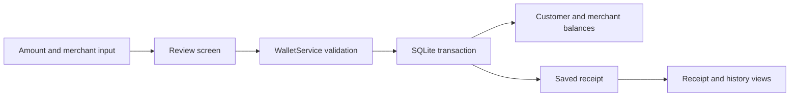

# PocketPay architecture

## Scope

PocketPay is an offline, single-device demonstration with one customer and three seeded merchants: Campus Cafe, Paper & Pages, and Daily Market. All use simulated INR balances. Switching to the merchant view changes what is displayed; it does not log into another account or connect to another phone.

The UI is Python/Kivy, persistence is SQLite, and Android packaging uses Buildozer with python-for-android. No API server, account authentication, card processing, bank transfer, camera scanning, or cloud synchronization is included.

## Data flow

`main.py` owns navigation and display. `wallet/service.py` validates amounts, handles transfers, and reads saved receipts. Core rules remain usable without importing Kivy, so they can be tested without a graphical environment.

## Database

| Table | Stored information |
| --- | --- |
| `accounts` | Stable ID, name, category, customer/merchant role, integer balance |
| `transactions` | Sequence, transaction ID, unique request ID, request fingerprint, operation type, merchant, amount, note, UTC timestamp, customer balance after the operation |

The database belongs to the application's local data directory. Each new install starts with zero balances; existing accounts are preserved on restart. Receipts reflect the values saved at payment time, rather than being recalculated from today's balance.

## Transaction rules

- Amounts are integer paise. Decimal text is parsed without binary floating-point arithmetic.
- Amounts must be positive, have at most two decimal places, and be at most INR 100,000.00 per operation. Account balances are capped at INR 1,000,000.00.
- The customer cannot spend more than the current balance. A destination must be a known merchant. Notes are limited to 120 characters.
- `BEGIN IMMEDIATE` serializes writers before reading and changing balances. Customer debit, merchant credit, and receipt insertion commit together; a failed operation rolls back.
- A request ID is unique. Retrying an identical operation with the same ID returns the previous receipt. Reusing the ID with different details is rejected.
- A payment moves the same amount between the customer and merchant. A demo top-up intentionally creates simulated funds.
- SQL values use parameters, and database constraints reject invalid balances and amounts.

These safeguards protect demo consistency. They do not make a client-controlled database tamper-proof, and this is not a full double-entry financial ledger.

## Tests and packaging

The standard-library test suite exercises the wallet independently of the UI. `tests/ui_smoke.py` exercises the Kivy interface on desktop; the Linux CI job supplies a virtual display. Neither replaces Android device testing.

The APK build uses Python 3.11.5, Kivy 2.3.1, python-for-android `v2024.01.21`, NDK 25b, API 33, minimum API 23, and arm64. Its requirements explicitly include the `sqlite3` Android recipe. Desktop development uses Python 3.12. The Android workflow runs after the Tests workflow succeeds on main, or by manual request, and uploads a debug APK only after a successful build.

The selected GitHub actions follow the official [checkout](https://github.com/actions/checkout), [setup-python](https://github.com/actions/setup-python), [setup-java](https://github.com/actions/setup-java), and [upload-artifact](https://github.com/actions/upload-artifact) usage. Build-tool downloads and transitive dependencies are not all locked, so this setup is not a fully reproducible build.

## Deliberate limitations

The app has no authentication, encrypted database, server reconciliation, refunds, pending network payments, multi-device access, or production monitoring. Device owners can change or delete local data. Clearing app storage erases the demo. There is no migration system for future incompatible schema changes.

A real payment product should keep authoritative money movement on a backend, use authenticated customer and merchant sessions, and reconcile provider-confirmed payment events. Adding a real payment button to this local database would not provide that architecture.
